# Come-down ERD (v0.3, 2026-11-12)

> v0.3: 팀장 "백엔드 설계 수정 요청 1" 반영 — `hrv_measurements` 서버 계산 컬럼, 하루 대표값 = 첫 적격 측정, `GOOD`→`NORMAL`, AI 고지 필수, 위험 주차 점수제, `weekly_loads.vs_usual_unavailable_reason` 추가. 계산 산식은 [계산_정책.md](계산_정책.md).

기준: 기획안 1차 수정본 + IA 차트 초안 ([서비스_요구사항.md](서비스_요구사항.md)). 서비스명은 Come-down(캄다운)입니다. 기존 구현과 독립적인 목표 데이터 설계입니다.
API는 [API.md](API.md)를 봅니다.

검토 결과는 [검토결과.md](검토결과.md), 관계도·테이블을 볼 수 있는 HTML은 [ERD.html](ERD.html)입니다.

## 0. 설계 원칙

| 원칙 | 내용 |
|---|---|
| DB | MySQL 8.4, InnoDB, utf8mb4. PK는 `BIGINT AUTO_INCREMENT`(1:1 테이블은 `user_id`가 PK) |
| 시각 | 순간은 `DATETIME(6)`에 **UTC**로 저장(`*_at`). 하루 단위 값은 **서울 날짜** `DATE`(`*_date`, `week_start`). 시각만 필요한 설정은 `TIME` |
| 개인정보 최소 수집 | 카메라 영상·원신호는 저장하지 않음(수치만). **일정 제목은 저장하지 않음**. 같은 제목끼리 묶어야 할 때는 되돌릴 수 없는 `title_hash`(HMAC-SHA256)만 저장 |
| 탈퇴 | 사용자 FK는 ON DELETE CASCADE. 제안→원본 일정의 RESTRICT 참조를 먼저 해제하고 외부 정리·세션 제거 후 사용자 삭제(6절) |
| 계산 | 회복·기준선·일정 부하·CBI 점수는 코드로 계산해 저장. AI 결과는 `ai_outputs`에 따로 두고 AI 생성 여부를 남김 |
| enum | DB에는 `VARCHAR`로 저장하고 허용 값은 앱에서 관리(3절). 값이 늘어나도 마이그레이션이 필요 없게 |

## 1. 관계도

```mermaid
erDiagram
    users ||--o{ user_consents : "동의 이력"
    users ||--o| user_settings : "생활 정보"
    users ||--o{ user_preferred_activities : "선호 회복 활동"
    users ||--o| oauth_tokens : "구글 토큰"
    users ||--o| subscriptions : "체험/구독"
    users ||--o{ cbi_assessments : "번아웃 체크"
    cbi_assessments ||--|{ cbi_answers : "13문항 응답"
    users ||--o{ calendar_events : "동기화한 일정"
    users ||--o{ event_category_overrides : "분류 직접 수정 규칙"
    users ||--o{ weekly_loads : "주간 일정 부하"
    users ||--o{ morning_checks : "아침 1분 체크"
    morning_checks ||--o{ hrv_measurements : "측정(재측정 포함)"
    users ||--o{ hrv_measurements : "측정"
    users ||--o{ hrv_daily_states : "일별 회복 상태"
    users ||--o{ suggestions : "제안·추천"
    calendar_events |o--o{ suggestions : "미리 시작할 대상 일정"
    users ||--o{ ai_outputs : "AI 해석"
    users ||--o{ safety_alerts : "안전 안내"
    users ||--o{ api_idempotency_keys : "중복 요청 방지"

    api_idempotency_keys {
        bigint id PK
        bigint user_id FK
        varchar operation
        varchar request_key
        char request_hash
        varchar status
        json response_body
        datetime expires_at
    }
    users {
        bigint id PK
        varchar google_sub UK
        varchar email
        varchar nickname
        varchar onboarding_step
        varchar deletion_status
        datetime onboarding_completed_at
        datetime created_at
        datetime last_login_at
    }
    user_consents {
        bigint id PK
        bigint user_id FK
        varchar consent_type
        varchar version
        datetime agreed_at
        datetime withdrawn_at
    }
    user_settings {
        bigint user_id PK
        time measure_time
        time sleep_start
        time sleep_end
        boolean hrv_enabled
        varchar reminder_google_event_id
        datetime updated_at
    }
    user_preferred_activities {
        bigint user_id PK
        varchar activity_code PK
    }
    oauth_tokens {
        bigint id PK
        bigint user_id FK
        text access_token_enc
        text refresh_token_enc
        varchar scopes
    }
    subscriptions {
        bigint user_id PK
        varchar plan
        datetime trial_started_at
        datetime trial_ends_at
    }
    cbi_assessments {
        bigint id PK
        bigint user_id FK
        varchar round
        decimal personal_score
        decimal work_score
        boolean high_risk
        datetime taken_at
    }
    cbi_answers {
        bigint assessment_id PK
        tinyint item_no PK
        tinyint answer_option
        tinyint answer_value
    }
    calendar_events {
        bigint id PK
        bigint user_id FK
        varchar google_event_id
        varchar recurring_event_id
        char title_hash
        datetime start_at
        datetime end_at
        boolean all_day
        boolean created_by_app
        varchar category
        varchar category_source
        tinyint burden
        boolean adjustable
        boolean is_deadline
    }
    event_category_overrides {
        bigint id PK
        bigint user_id FK
        varchar scope
        varchar match_key
        varchar category
        boolean is_deadline
    }
    weekly_loads {
        bigint user_id PK
        date week_start PK
        decimal load_score
        decimal vs_usual_pct
        smallint deadline_count
        smallint late_night_count
        tinyint rest_days
        varchar risk_level
    }
    morning_checks {
        bigint id PK
        bigint user_id FK
        date check_date
        datetime breathing_completed_at
        tinyint condition_score
        boolean alcohol
        boolean sick
        boolean caffeine
        datetime completed_at
    }
    hrv_measurements {
        bigint id PK
        bigint user_id FK
        bigint morning_check_id FK
        datetime measured_at
        double rmssd_ms
        double ln_rmssd
        double noise_ratio
        varchar quality_level
        varchar retry_reason
        varchar algorithm_version
    }
    hrv_daily_states {
        bigint user_id PK
        date state_date PK
        double daily_ln_rmssd
        boolean confounded
        double baseline_mean_ln
        double baseline_sd_ln
        double trend_ln
        decimal change_pct
        varchar recovery_status
    }
    suggestions {
        bigint id PK
        bigint user_id FK
        varchar type
        varchar status
        varchar registration_key UK
        boolean is_fallback
        datetime start_at
        datetime end_at
        bigint related_event_id FK
        varchar google_event_id
    }
    ai_outputs {
        bigint id PK
        bigint user_id FK
        varchar kind
        date ref_date
        text content
        boolean is_fallback
    }
    safety_alerts {
        bigint id PK
        bigint user_id FK
        varchar trigger_type
        datetime triggered_at
        datetime acknowledged_at
    }
```

로그인 세션은 Spring Session JDBC 표준 테이블(`SPRING_SESSION`, `SPRING_SESSION_ATTRIBUTES`)을 그대로 씁니다. 도메인 관계가 없어 그림에서 뺐습니다.

## 2. 테이블 정의

표기: **PK** 기본키, **UK** 유니크, **FK** 외래키(`users.id`로 향하는 FK는 `ON DELETE CASCADE`, 그 외는 각 표의 명시 규칙). Null 칸이 비어 있으면 NOT NULL.

### 2-1. 회원·설정 (온보딩, 마이페이지)

#### `users` — 회원
| 컬럼 | 타입 | Null | 설명 |
|---|---|---|---|
| id | BIGINT | | PK |
| google_sub | VARCHAR(64) | | UK. 구글 계정 고유 id(OIDC `sub`) |
| email | VARCHAR(320) | Y | 구글 이메일. 계정 확인용 |
| nickname | VARCHAR(20) | Y | 닉네임(가입 단계에서 입력, 그 전엔 null) |
| onboarding_step | VARCHAR(20) | | `PROFILE` → `CBI` → `LIFESTYLE` → `SCHEDULE_REPORT` → `DONE`. 중간에 나가도 이어서 진행 |
| onboarding_completed_at | DATETIME(6) | Y | 온보딩을 끝낸 시각. **가입 n일차·28일차 계산 기준** |
| created_at | DATETIME(6) | | |
| last_login_at | DATETIME(6) | | |
| deletion_status | VARCHAR(20) | | ACTIVE / DELETING, 기본 ACTIVE |
| deletion_requested_at | DATETIME(6) | Y | 탈퇴 요청 시각 |

- 구글 이름(`name`)은 받지 않습니다(닉네임으로 대체, 최소 수집).

#### `user_consents` — 동의 이력
| 컬럼 | 타입 | Null | 설명 |
|---|---|---|---|
| id | BIGINT | | PK |
| user_id | BIGINT | | FK |
| consent_type | VARCHAR(30) | | `TERMS` `PRIVACY` `AGE_14` `SENSITIVE_HRV` `CALENDAR` `AI_NOTICE`(AI 활용 사전 고지, 가입 필수) |
| version | VARCHAR(20) | | 약관·고지 문서 버전 (예: `2026-11-01`) |
| agreed_at | DATETIME(6) | | |
| withdrawn_at | DATETIME(6) | Y | 철회 시각. null이면 유효 |

- 인덱스: `(user_id, consent_type, agreed_at)`
- 동의를 다시 하면 새 행. "현재 유효한 동의" = 타입별 최신 행의 `withdrawn_at`이 null.
- `SENSITIVE_HRV`를 철회하면 측정이 꺼지고(`user_settings.hrv_enabled=false`) 측정값 삭제를 함께 제공.

#### `user_settings` — 생활 정보 (1:1)
| 컬럼 | 타입 | Null | 설명 |
|---|---|---|---|
| user_id | BIGINT | | PK, FK |
| measure_time | TIME | Y | 아침 측정 시간(기상 직후 권장) |
| sleep_start | TIME | | 기본 `23:00`. 추천 빈 시간 탐색에서 제외 |
| sleep_end | TIME | | 기본 `07:00` |
| hrv_enabled | BOOLEAN | | 측정 사용 여부(건강정보 동의와 함께 켜짐) |
| reminder_google_event_id | VARCHAR(255) | Y | 측정 알림을 캘린더 반복 일정으로 넣었을 때 그 일정 id. (결정 대기: API 문서 열린 항목 2) |
| updated_at | DATETIME(6) | | |

#### `user_preferred_activities` — 선호 회복 활동 (복수 선택)
| 컬럼 | 타입 | Null | 설명 |
|---|---|---|---|
| user_id | BIGINT | | PK(1), FK |
| activity_code | VARCHAR(30) | | PK(2). `WALK` `STRETCH` `NAP` `YOGA` `MEDITATION` `LIGHT_RUN` |

#### `oauth_tokens` — 구글 토큰
| 컬럼 | 타입 | Null | 설명 |
|---|---|---|---|
| id | BIGINT | | PK |
| user_id | BIGINT | | FK |
| provider | VARCHAR(20) | | `google`. UK(provider, principal_name), UK(user_id, provider). 현재는 사용자별 google 1개 |
| principal_name | VARCHAR(64) | | 구글 sub |
| access_token_enc / refresh_token_enc | TEXT | refresh는 Y | AES-256-GCM 암호화 |
| access_token_issued_at / access_token_expires_at | DATETIME(6) | Y | |
| scopes | VARCHAR(1000) | | 사용자가 실제로 허용한 범위(캘린더 체크 해제 여부 판단) |
| updated_at | DATETIME(6) | | |

#### `subscriptions` — 무료 체험·구독 (1:1, MVP는 체험 기간만)
| 컬럼 | 타입 | Null | 설명 |
|---|---|---|---|
| user_id | BIGINT | | PK, FK |
| plan | VARCHAR(20) | | `TRIAL` `FREE` `PREMIUM` |
| trial_started_at | DATETIME(6) | | 온보딩 완료 시각 |
| trial_ends_at | DATETIME(6) | | 시작 + 28일 |
| current_period_end | DATETIME(6) | Y | 결제 연동 후 사용 |
| updated_at | DATETIME(6) | | |

### 2-2. 번아웃 체크 (CBI)

#### `cbi_assessments` — 응답 1회
| 컬럼 | 타입 | Null | 설명 |
|---|---|---|---|
| id | BIGINT | | PK |
| user_id | BIGINT | | FK |
| round | VARCHAR(20) | | `INITIAL`(가입) `DAY28`(28일차) `FOLLOW_UP`(이후) |
| questionnaire_version | VARCHAR(20) | | 문항 버전(문항 문구는 코드에 둠) |
| personal_score | DECIMAL(5,2) | | 몸과 마음의 피로(개인적 소진, 6문항 평균, 0~100) |
| work_score | DECIMAL(5,2) | | 일·공부로 인한 피로(일·학업 관련 소진, 7문항 평균, 0~100) |
| high_risk | BOOLEAN | | 두 점수 중 하나라도 75 이상 → 안전 안내 |
| taken_at | DATETIME(6) | | |

- 인덱스: `(user_id, taken_at)`. MVP는 INITIAL·DAY28만 지원하며 **UK(user_id, round)**로 회차 중복을 DB에서도 차단합니다. FOLLOW_UP은 향후 별도 회차 번호 설계 후 활성화합니다.

#### `cbi_answers` — 문항별 응답
| 컬럼 | 타입 | Null | 설명 |
|---|---|---|---|
| assessment_id | BIGINT | | PK(1), FK → `cbi_assessments.id`, ON DELETE CASCADE |
| item_no | TINYINT | | PK(2). 1~6 개인적 소진, 7~13 일·학업 |
| answer_option | TINYINT | | 원래 선택 보기 0~4. 문항 버전은 부모 assessment에 저장 |
| answer_value | TINYINT | | 0·25·50·75·100으로 환산한 값(역문항은 뒤집어 저장) |

### 2-3. 캘린더·일정 부하

#### `calendar_events` — 동기화한 구글 일정 (제목 없음)
| 컬럼 | 타입 | Null | 설명 |
|---|---|---|---|
| id | BIGINT | | PK |
| user_id | BIGINT | | FK. UK(user_id, calendar_id, google_event_id) |
| calendar_id | VARCHAR(255) | | `primary` |
| google_event_id | VARCHAR(255) | | 반복 일정은 회차별 id |
| recurring_event_id | VARCHAR(255) | Y | 반복 일정 묶음 id ("반복 전체에 적용"에 사용) |
| title_hash | CHAR(64) | Y | HMAC-SHA256(서버 키, user_id + 정규화한 제목). 원문 대신 저장하는 식별값. "같은 제목 일정에 적용"·분류 재사용에 사용 |
| start_at / end_at | DATETIME(6) | | UTC |
| all_day | BOOLEAN | | |
| event_status | VARCHAR(20) | | `confirmed` `tentative` |
| transparency | VARCHAR(20) | | `opaque`(바쁨) `transparent`(한가함) |
| created_by_app | BOOLEAN | | Come-down이 넣은 일정(회복 일정·작업 블록). 부하 계산에서 제외 |
| category | VARCHAR(30) | Y | 3절 일정 카테고리. 분류 전이면 null |
| category_source | VARCHAR(10) | Y | `AI` `RULE`(AI 실패 시 규칙) `USER`(직접 수정) |
| burden | TINYINT | Y | 부담 정도 1~3 |
| adjustable | BOOLEAN | Y | 미리 시작할 수 있는 일인지(과제·발표 준비 등) |
| is_deadline | BOOLEAN | Y | 마감 몰림 집계 대상(과제 마감·시험·발표) |
| classified_at | DATETIME(6) | Y | |
| google_updated_at | DATETIME(6) | Y | |
| synced_at | DATETIME(6) | | |

- 인덱스: `(user_id, start_at)`, `(user_id, recurring_event_id)`, `(user_id, title_hash)`
- 동기화 범위: 시작 = min(오늘 − 1개월, 이번 주 월요일 − 4주), 끝 = 이번 주 월요일 + 5주.
- 재동기화 때 `category_source = USER`인 값은 덮어쓰지 않습니다.

#### `event_category_overrides` — 분류 직접 수정 규칙
| 컬럼 | 타입 | Null | 설명 |
|---|---|---|---|
| id | BIGINT | | PK |
| user_id | BIGINT | | FK. UK(user_id, calendar_id, scope, match_key) |
| scope | VARCHAR(10) | | `THIS`(이 일정만) `SERIES`(반복 일정 전체) `TITLE`(같은 제목 일정) |
| match_key | VARCHAR(255) | | THIS면 google_event_id, SERIES면 recurring_event_id, TITLE이면 title_hash |
| calendar_id | VARCHAR(255) | | 기본 primary. UK는 (user_id, calendar_id, scope, match_key) |
| category | VARCHAR(30) | | |
| burden | TINYINT | Y | |
| adjustable | BOOLEAN | Y | |
| is_deadline | BOOLEAN | | 직접 수정한 마감 여부 |
| created_at / updated_at | DATETIME(6) | | |

- 모든 직접 수정은 규칙으로도 남겨 재동기화 시 보존합니다. 우선순위는 THIS > SERIES > TITLE > AI > RULE. SERIES/THIS에는 calendar_id도 매칭하며 TITLE 해시는 사용자 id를 포함한 HMAC으로 사용자 간 연결을 방지합니다.
- `is_deadline` BOOLEAN NOT NULL도 저장해 마감 몰림 집계가 직접 수정과 일치하게 합니다.

#### `weekly_loads` — 주간 일정 부하 (계산 결과 캐시)
| 컬럼 | 타입 | Null | 설명 |
|---|---|---|---|
| user_id | BIGINT | | PK(1), FK |
| week_start | DATE | | PK(2). 월요일 |
| total_hours | DECIMAL(5,1) | | 집계 대상 일정 시간 합(일 관련 + OTHER + 미분류. 개인·앱 생성·한가함·취소·종일 일정 제외) |
| load_score | DECIMAL(6,1) | | Σ(일정 시간 × 가중치). `load-v1`: 시험·발표 ×1.5, 22~07시·주말 ×1.5, 곱 최대 2.25 |
| vs_usual_pct | DECIMAL(6,1) | Y | (이번 주 부하 점수 ÷ 직전 4주 평균 − 1) × 100. 계산 불가 시 null |
| vs_usual_unavailable_reason | VARCHAR(30) | Y | vs_usual_pct가 null인 이유: `ZERO_BASELINE`(직전 4주 평균 0) `INSUFFICIENT_DATA`(직전 데이터 2주 미만) |
| deadline_count | SMALLINT | | 마감 몰림(과제 마감·시험·발표 수) |
| late_night_count | SMALLINT | | 22시 이후 끝나거나 07시 이전 시작 |
| weekend_hours | DECIMAL(5,1) | | |
| rest_days | TINYINT | | 일 관련 일정이 없는 날 수(0~7) |
| risk_level | VARCHAR(10) | | 조건 점수 합: 0~1 `NONE` / 2~3 `WATCH` / 4 이상 `RISK`(위험한 주) |
| risk_reasons | JSON | | 배열: LOAD_HIGH, DEADLINES, NO_REST_DAY, LATE_NIGHT, LONG_STREAK. 없으면 [] |
| calculation_version | VARCHAR(30) | | 계산 정책 버전 |
| computed_at | DATETIME(6) | | |

- 동기화가 끝날 때마다 범위 안의 주를 다시 계산합니다. 지난 주(과거)와 앞으로 4주가 같은 표에 들어갑니다.

### 2-4. 아침 1분 체크·회복

#### `morning_checks` — 하루 아침 체크 1회 (측정 → 컨디션 → 호흡 → 결과)

결과 계산과 완료(`completed_at`)는 컨디션 저장 기준이며, 호흡은 건너뛸 수 있습니다.

| 컬럼 | 타입 | Null | 설명 |
|---|---|---|---|
| id | BIGINT | | PK |
| user_id | BIGINT | | FK. UK(user_id, check_date) |
| check_date | DATE | | 서울 날짜 |
| day_index | INT | | 생성 당시 n일차 스냅샷. 현재 일차는 onboarding_completed_at의 서울 날짜로 계산 |
| breathing_completed_at | DATETIME(6) | Y | 호흡 훈련 1분 완료 |
| condition_score | TINYINT | Y | 내가 느끼는 컨디션 1~5 |
| alcohol / sick / caffeine | BOOLEAN | Y | 하나라도 true면 그날은 '내 평소' 계산에서 제외 |
| completed_at | DATETIME(6) | Y | 컨디션 체크까지 끝난 시각 |
| created_at | DATETIME(6) | | |

#### `hrv_measurements` — HRV 측정 1건 (재측정도 각각 저장)
CAMERA는 프론트가 보낸 밝기 배열(t·r·g)로 **서버가** RMSSD·품질을 계산해 저장합니다. 원신호는 저장하지 않습니다(local 프로필에서만 조정용 파일 저장 플래그). RETRY도 행으로 남깁니다.

| 컬럼 | 타입 | Null | 설명 |
|---|---|---|---|
| id | BIGINT | | PK |
| user_id | BIGINT | | FK. 인덱스 (user_id, measured_at) |
| morning_check_id | BIGINT | | FK → morning_checks(user_id, id) 복합 FK에 user_id와 함께 참조, ON DELETE CASCADE. 수동 입력도 오늘 체크에 연결 |
| measured_at | DATETIME(6) | | UTC. CAMERA는 요청 `startedAt`(측정 시작), MANUAL은 `measuredAt` |
| source | VARCHAR(16) | | `CAMERA` `MANUAL`(카메라를 못 쓰는 기기에서 워치 값 입력) |
| rmssd_ms / ln_rmssd | DOUBLE | Y | ln은 서버가 계산. RETRY면 null, 그 외 필수(CHECK) |
| mean_hr_bpm | DOUBLE | Y | 심박수(참고용 표시). RETRY면 null |
| valid_beats / rejected_beats | INT | Y | 서버 계산: 유효 / 제외된 박동 간격 수 |
| noise_ratio | DOUBLE | Y | 서버 계산 잡음비(6Hz 이상 고주파 MAD ÷ 박동 진폭). 기존 `snr` 대체 |
| quality_level | VARCHAR(12) | | 서버 판정 GOOD·FAIR·RETRY·UNVERIFIED(수동값). RETRY·UNVERIFIED는 기준선·자동 판정에서 제외 |
| retry_reason | VARCHAR(20) | Y | `TOO_SHORT` `LOW_FPS` `NO_PULSE` `TOO_NOISY`. RETRY일 때만 필수(CHECK) |
| algorithm_version | VARCHAR(30) | | 계산 알고리즘 버전(CAMERA: `hrv-cam-v1`) |
| time_source | VARCHAR(16) | Y | `captureTime` `mediaTime` `performance` |
| frame_count | INT | Y | 서버 계산: 분석에 쓴 프레임 수 |
| channel | CHAR(1) | Y | 채택한 채널 `R` / `G` |
| duration_sec / fps | DOUBLE | Y | 서버 계산 |
| torch | BOOLEAN | Y | 플래시 켜짐 |
| created_at | DATETIME(6) | | |

#### `hrv_daily_states` — 일별 회복 상태 (계산 결과)
측정 또는 컨디션을 저장한 날마다 1행. 재측정·컨디션 변경·삭제 시 그 날짜부터 오늘까지 다시 계산합니다(`recovery-v1`, [계산_정책.md](계산_정책.md) 4절). 측정하지 않은 날은 '2주 연속 낮음' 판정에서 빠집니다. 그래프·회복 리포트·'2주 연속 낮음'·내 범위 중 현재 위치를 이 표로 봅니다.

| 컬럼 | 타입 | Null | 설명 |
|---|---|---|---|
| user_id | BIGINT | | PK(1), FK |
| state_date | DATE | | PK(2) |
| daily_ln_rmssd | DOUBLE | Y | **하루 대표값** = 그날 첫 번째 적격(GOOD·FAIR) 측정의 ln 값. 첫 측정이 RETRY이고 재측정이 적격이면 그 재측정. 적격 측정 없는 날은 null |
| daily_rmssd_ms | DOUBLE | Y | exp(대표값) = 대표 측정의 RMSSD(ms). 표시용 |
| measurement_count | INT | | 그날 적격 측정 수(대표값 외 포함). 측정 없는 날은 0 |
| quality_level | VARCHAR(12) | Y | 대표 측정의 품질. 없으면 null |
| confounded | BOOLEAN | | 음주·아픔·카페인 → 기준선 제외("오늘은 계산에서 빠졌어요") |
| baseline_established | BOOLEAN | | 적격일 7일 이상(초기 기준선 확정) |
| baseline_valid_days | SMALLINT | | "기준선 만드는 중 n/7"의 n |
| baseline_mean_ln / baseline_sd_ln | DOUBLE | Y | 그날 시점 '내 평소'(ln)와 표준편차. 초기 7일 평균·표준편차 후 지수 이동 평균(반감기 14일) 갱신, SD 최소 0.05 |
| baseline_sample_count | SMALLINT | | 기준선에 들어간 날 수 |
| baseline_frozen | BOOLEAN | | 회복 낮음(LOW)이라 갱신을 멈춘 상태 |
| trend_ln | DOUBLE | Y | 최근 7일 안의 대표값 평균(교란일 제외, 3개 이상일 때) |
| change_pct | DECIMAL(6,1) | Y | 평소 대비 % = (exp(trend_ln − baseline_mean_ln) − 1) × 100 |
| recovery_status | VARCHAR(20) | | `BUILDING` `NORMAL` `LOW` `INSUFFICIENT` |
| calculation_version | VARCHAR(30) | | 계산 정책 버전 |
| computed_at | DATETIME(6) | | |

### 2-5. 제안·추천, AI, 안전

#### `suggestions` — 과부하 대비 제안 + 회복 일정 추천 (공용)
| 컬럼 | 타입 | Null | 설명 |
|---|---|---|---|
| id | BIGINT | | PK |
| user_id | BIGINT | | FK. 인덱스 (user_id, status, start_at) |
| type | VARCHAR(20) | | `PRE_START`(미리 시작하기, 작업 블록) `RECOVERY`(운동·휴식) |
| status | VARCHAR(20) | | `PROPOSED` → `APPROVING` → `APPROVED`; 기타 DISMISSED·EXPIRED·FAILED·UNDONE (API 상태 전이 규칙 참고) |
| target_date | DATE | | 제안이 걸린 날짜(오늘의 추천 조회용) |
| start_at / end_at | DATETIME(6) | | 넣을 시간(승인 때 사용자가 바꿀 수 있음) |
| title | VARCHAR(100) | | 캘린더에 들어갈 제목(앱이 만든 문구. 예: "20분 걷기") |
| activity_code | VARCHAR(30) | Y | RECOVERY일 때 활동 |
| judgment_state | VARCHAR(30) | Y | 추천 근거가 된 2축 판단(3절) |
| reason_code | VARCHAR(30) | | `RISK_WEEK` `LOW_RECOVERY` `LOW_CONDITION` `OVERLOAD` … |
| calculation_version | VARCHAR(30) | | 계산 정책 버전 |
| message | VARCHAR(300) | Y | 카드 설명 문구 |
| ai_generated | BOOLEAN | | message/활동을 AI가 만들었으면 true("AI 생성" 표시) |
| is_fallback | BOOLEAN | | AI 실패 후 규칙 기반 대체 여부. API message.fallback에 대응 |
| registration_key | VARCHAR(64) | | UK. 서버가 생성한 Google event id. 승인 시작 전에 영속화하고 재시도에 재사용 |
| updated_at | DATETIME(6) | | 상태 갱신 시각 |
| related_event_id | BIGINT | Y | user_id와 복합 FK → calendar_events(user_id, id), ON DELETE RESTRICT. 삭제 전 참조 id만 null로 처리(6절) |
| risk_week_start | DATE | Y | PRE_START가 대비하는 위험 주 |
| google_event_id | VARCHAR(255) | Y | 승인 후 만든 구글 일정 id |
| decided_at | DATETIME(6) | Y | 승인·거절 시각 |
| done_at | DATETIME(6) | Y | 사용자가 "했어요" 체크(다음 날 효과 확인) |
| expires_at | DATETIME(6) | | 지나면 EXPIRED |
| created_at | DATETIME(6) | | |

- 하루 추천 개수 제한(초안 기본 2개)은 앱 설정값으로 둡니다.

#### `ai_outputs` — AI 해석·문구 (캐시 + 고지 근거)
| 컬럼 | 타입 | Null | 설명 |
|---|---|---|---|
| id | BIGINT | | PK |
| user_id | BIGINT | | FK. UK(user_id, kind, ref_date, input_hash) |
| kind | VARCHAR(30) | | `RECOVERY_INTERPRETATION`(회복 리포트 AI 해석) `HOME_SUMMARY` `FOUR_WEEK_SUMMARY` |
| ref_date | DATE | | 기준 날짜 |
| input_hash | CHAR(64) | | 입력 수치의 해시. 같으면 다시 부르지 않음 |
| content | TEXT | | 2~3문장 |
| model | VARCHAR(50) | Y | 사용 모델. 대체 문구면 null |
| is_fallback | BOOLEAN | | AI 실패로 규칙 기반 문구를 썼으면 true |
| created_at | DATETIME(6) | | |

- 일정 분류 결과는 `calendar_events`에 바로 저장하므로 여기 넣지 않습니다.

#### `safety_alerts` — 도움 받을 수 있는 곳 노출 기록
| 컬럼 | 타입 | Null | 설명 |
|---|---|---|---|
| id | BIGINT | | PK |
| user_id | BIGINT | | FK |
| trigger_type | VARCHAR(30) | | `LOW_RECOVERY_2W`(회복 2주 연속 낮음) `CBI_HIGH`(CBI 75점 이상) |
| source_ref | VARCHAR(50) | Y | 근거(예: cbi_assessments.id, 낮음 시작 날짜) |
| triggered_at | DATETIME(6) | | |
| acknowledged_at | DATETIME(6) | Y | 사용자가 "닫기" |
| resolved_at | DATETIME(6) | Y | 조건이 풀림(다시 노출 기준) |

## 3. 코드 값(enum)

| 이름 | 값 |
|---|---|
| OnboardingStep | `PROFILE` `CBI` `LIFESTYLE` `SCHEDULE_REPORT` `DONE` |
| ConsentType | `TERMS` `PRIVACY` `AGE_14` `SENSITIVE_HRV` `CALENDAR` `AI_NOTICE` |
| ActivityCode | `WALK` 걷기 · `STRETCH` 스트레칭 · `NAP` 낮잠 · `YOGA` 요가 · `MEDITATION` 명상 · `LIGHT_RUN` 가벼운 러닝 |
| EventCategory | 일 관련(부하 계산 대상): `CLASS` 수업 · `ASSIGNMENT` 과제 · `EXAM` 시험 · `PRESENTATION` 발표 · `PART_TIME` 아르바이트 · `CLUB` 동아리·대외활동 · `WORK_MEETING` 회의·팀플 · `STUDY` 공부 / 개인(제외): `EXERCISE` 운동 · `APPOINTMENT` 약속 · `PERSONAL` 개인 · `RECOVERY` 회복(앱이 만든 일정) / `OTHER` |
| CategorySource | `AI` `RULE` `USER` |
| RiskLevel | `NONE`(0~1점) `WATCH`(2~3점) `RISK`(4점 이상, 위험한 주) — 점수는 [계산_정책.md](계산_정책.md) 1절 |
| RiskReason | `LOAD_HIGH` `DEADLINES` `NO_REST_DAY` `LATE_NIGHT` `LONG_STREAK` |
| QualityLevel | `GOOD` 좋음 · `FAIR` 보통 · `RETRY` 다시 측정 · `UNVERIFIED` 수동 참고값 |
| RetryReason | `TOO_SHORT` `LOW_FPS` `NO_PULSE` `TOO_NOISY` |
| RecoveryStatus | `BUILDING`(기준선 만드는 중) `NORMAL`(평소 범위) `LOW` `INSUFFICIENT`(최근 7일 대표값 3개 미만) |
| JudgmentState (2축) | `INSUFFICIENT`(최근 자료 부족) · `OK`(보통·정상) `OVERLOAD_OK`(과부하·정상 → 미리 분산, 짧은 휴식) `OVERLOAD_LOW`(과부하·낮음 → 일정 조정 + 회복, 최우선) `NORMAL_LOW`(보통·낮음 → 수면·가벼운 운동) `BUILDING`(유효 측정 7일 확보 전, 컨디션 기준) |
| SuggestionType / Status | `PRE_START` `RECOVERY` / `PROPOSED` `APPROVING` `APPROVED` `DISMISSED` `EXPIRED` `FAILED` `UNDONE` |
| CbiRound | `INITIAL` `DAY28` `FOLLOW_UP` |
| Plan | `TRIAL` `FREE` `PREMIUM` |
| SafetyTrigger | `LOW_RECOVERY_2W` `CBI_HIGH` |

## 4. 데이터 소유권과 폴더 연결

각 테이블의 쓰기 소유자는 하나입니다. 18개 테이블의 기능별 소유권은 [책임_매핑.md](책임_매핑.md), 복합 업무 흐름과 신규 패키지는 [백엔드_구조설계.md](백엔드_구조설계.md)를 따릅니다. 기존 구현 테이블을 변환하는 것이 신규 구조 설계의 출발점은 아닙니다.

## 5. 정해야 할 것
1. `title_hash`를 쓸지: "같은 제목 일정에 적용" 기능이 필요 없으면 빼도 됩니다(반복 일정 전체 적용만으로 충분한지).
2. 측정 알림을 캘린더 반복 일정으로 할지(`reminder_google_event_id`).
3. ~~'2주 연속 낮음' 정의~~ → v0.3 확정: 최근 14일 중 대표값 있는 날 7일 이상, 그 날들이 모두 LOW([계산_정책.md](계산_정책.md) 5절).
4. ~~회복 점수 숫자~~ → v0.3 확정: 0~100 점수를 쓰지 않으며 `recovery_score` 칸을 추가하지 않음.

## 6. 무결성·삭제·재시도 보완 (v0.2)

### `api_idempotency_keys` — 중복 저장·등록 방지
| 컬럼 | 타입 | Null | 설명 |
|---|---|---|---|
| id | BIGINT | | PK |
| user_id | BIGINT | | FK → users.id, ON DELETE CASCADE |
| operation | VARCHAR(80) | | 작업+리소스 식별자. 예: suggestion:31:approve |
| request_key | VARCHAR(36) | | 요청 Idempotency-Key. UK(user_id, operation, request_key) |
| request_hash | CHAR(64) | | 요청 본문 정규화 후 해시 |
| status | VARCHAR(20) | | PROCESSING / COMPLETED |
| response_status | SMALLINT | Y | 저장한 HTTP 상태 코드 |
| response_body | JSON | Y | 재전송 응답. 건강정보와 동일한 접근·삭제 정책 적용 |
| created_at / expires_at | DATETIME(6) | | 최소 24시간 보관 후 만료 정리. 진행 중인 외부 승인 작업은 확인 전 제거하지 않음 |

- 복합 FK: morning_checks에 UK(user_id, id), calendar_events에 UK(user_id, id)를 추가합니다. hrv_measurements(user_id, morning_check_id)는 같은 사용자 체크만 참조합니다. suggestions(user_id, related_event_id)는 같은 사용자 일정만 참조합니다.
- suggestions의 일정 참조는 복합 FK `ON DELETE RESTRICT`로 둡니다. 원본 일정을 지우기 전에 앱 트랜잭션에서 related_event_id만 null로 바꾼 뒤 삭제합니다(user_id를 null로 만드는 복합 SET NULL은 사용하지 않음). 탈퇴는 제안→일정→사용자 순으로 정리하여 RESTRICT 충돌을 피합니다.
- CHECK: condition_score 1~5, burden 1~3, CBI option 0~4·점수 0~100, end_at > start_at, rmssd_ms > 0, rest_days 0~7. NULL 허용 필드는 미입력 상태를 보존합니다. 정확히 13개 CBI 답변+부모 점수 저장은 한 트랜잭션입니다.
- 기준선·추세는 모두 ln(RMSSD) 단위로 계산·저장하고 화면 표시만 exp로 ms 변환합니다(단순 RMSSD 산술 평균 미사용). API의 trendRmssdMs는 exp(trend_ln). 초기 기준선에는 "최근 7일 제외"를 적용하지 않습니다(v0.3 확정, [계산_정책.md](계산_정책.md) 4절).
- confounded=false만으로 기준선에 포함하지 않습니다. morning_checks의 컨디션과 교란 요인 입력이 모두 완료된 적격 측정일만 포함합니다.
- API의 WeekLoad는 weekly_loads, TodayResult.recovery는 hrv_daily_states, Suggestion.message는 message+ai_generated+is_fallback으로 대응합니다. risk_reasons는 DB JSON 배열로 저장하고 API 배열로 반환합니다(기존 쉼표 문자열 설계 대체).
- 캘린더 연결 해제 시 calendar_events·event_category_overrides·weekly_loads·미승인 제안·일정 기반 AI 캐시를 정리합니다. 승인 이력의 related_event_id는 null. 동기화한 일정의 삭제·분류 변경 뒤 주간 부하와 제안도 갱신합니다.
- 건강 기록 삭제 범위: hrv_measurements·hrv_daily_states·CBI 부모/응답·컨디션/교란 요인·건강 기반 AI/안전 기록·관련 중복 응답 캐시. morning_checks의 건강 필드와 completed_at을 null로 초기화하며 승인 이력의 건강 근거를 제거합니다. 삭제한 값을 재계산·재시도 캐시가 복원하지 않게 합니다.
- 사용자 탈퇴 시 Spring Session의 principal 색인으로 해당 사용자의 모든 세션도 제거합니다. 외부 토큰 철회·일정 정리가 남으면 계정을 DELETING 상태로 표시하고 재시도합니다. users에 deletion_status VARCHAR(20) NOT NULL DEFAULT ACTIVE와 deletion_requested_at DATETIME(6) NULL을 추가하며 완료 후 물리 삭제합니다. 외부 작업에 필요한 암호화 토큰은 삭제 완료 전까지만 보관합니다.
- 제안 승인 재시도는 registration_key에 해당하는 Google 일정 존재를 먼저 확인합니다. 고유 제약·사용자별 잠금·외부 결과 대조를 함께 사용합니다. 서버는 외부 일정 등록과 DB를 하나의 트랜잭션으로 간주하지 않습니다.
- 정책 버전 추적: weekly_loads·hrv_daily_states·suggestions에 calculation_version VARCHAR(30) NOT NULL을 추가합니다. 일정 가중치·안전 연속성·기준선 규칙 변경 시 파생 데이터를 재계산합니다.
